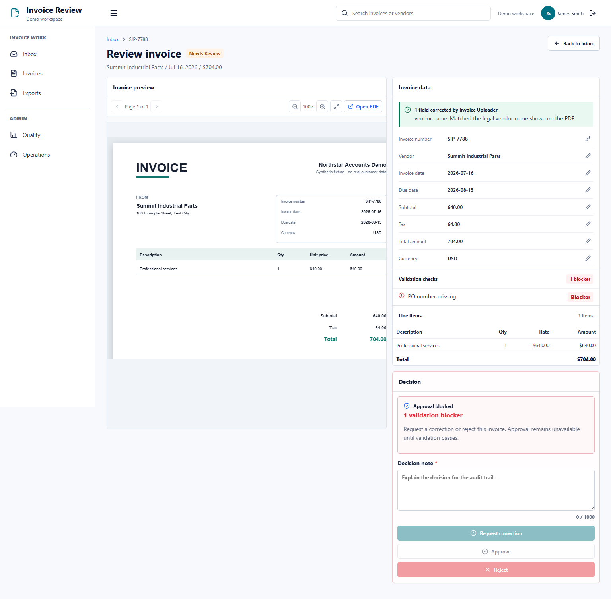
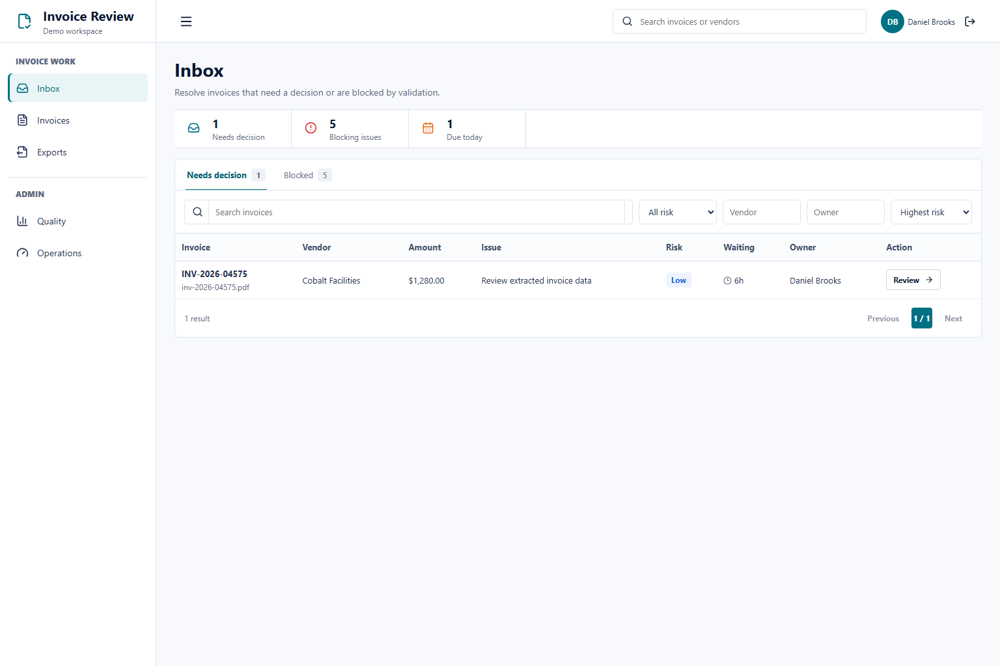
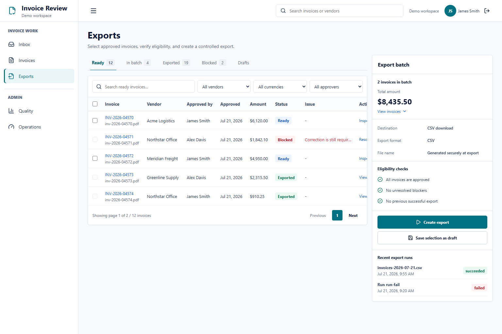
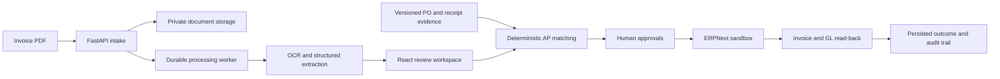

# AI Document — Invoice Review

An evidence-linked accounts-payable workspace, from invoice PDF to verified ERP posting.

Invoice Review helps an AP team inspect AI-extracted invoice fields, compare them with purchase
orders and receipts, resolve discrepancies, and approve controlled ERPNext actions. Every posting
requires explicit human authority and independent invoice and ledger read-back.

> From an invoice PDF to an approved, verifiable accounting outcome.

[](docs/assets/demo/invoice-review-demo.mp4)

[Product walkthrough](docs/assets/demo/invoice-review-demo.mp4) · [Engineering case study](docs/PORTFOLIO_CASE_STUDY.md) · [Evidence and documentation](docs/INDEX.md)

## Evidence Snapshot

| Result                                      | Measured scope                                                                                                             | Evidence                                                                       |
| ------------------------------------------- | -------------------------------------------------------------------------------------------------------------------------- | ------------------------------------------------------------------------------ |
| **50/50**                                   | Whole-invoice values and required source provenance correct on frozen synthetic invoices                                   | [Quality results](docs/evidence/invoice-review-v2/quality-holdout/report.json) |
| **20/20 posted; 30/30 exceptions resolved** | Eligible local ERPNext submissions verified against invoice and ledger; non-payable cases received authorized dispositions | [Technical evaluation](docs/evidence/invoice-review-v2/PHASE-6.md)             |
| **20/20**                                   | Restart replays returned the same ERP target, with no duplicate posting effects                                            | [Posting verification](docs/evidence/invoice-review-v2/posting/report.json)    |
| **3 dated revisions**                       | Supplier/rule changes recovered with verified posting and retained previously correct development cases                    | [Revision replay](docs/evidence/invoice-review-v2/replay/report.json)          |
| **68.0%**                                   | Lower median elapsed time to a verified ERPNext draft: 49 s assisted versus 153 s manual                                   | [Paired draft benchmark](docs/erpnext-paired-draft-timing-results.md)          |
| **Verified recovery**                       | Packaged Docker workflow recovered a lost submit response, survived restart and restored SQLite/uploads                    | [Release evidence](docs/evidence/invoice-review-v2/PHASE-7.md)                 |

The quality evaluation contains 50 developer/AI-assisted synthetic, one-line USD invoices across
40 quality families, including ten duplicate pairs. It measures these controlled cases, rather than
accuracy on arbitrary customer documents. Quantity, price, receipt and duplicate checks recorded
no false holds, unsafe submissions or duplicate ERP effects in that cohort.

The timing benchmark is a **separate six-invoice, single-operator synthetic study**. Both conditions
ended at a verified Purchase Invoice Draft; active work and system waiting were not separated.
It does not measure time savings for the submitted-posting workflow.

## Why It Exists

Reading an invoice is only the beginning. AP work also requires knowing whether the supplier is
mapped correctly, the quantity was received, the price agrees with the purchase order, and the
invoice has already been billed. A plausible extraction cannot answer those questions by itself.

Invoice Review keeps the source, matching evidence, exception decision, approval and ERP result
connected so an operator can explain why a transaction was posted or held.

## Product Workflow

```text
Invoice PDF -> OCR and structured extraction -> Source-linked review
            -> Purchase order and receipt matching -> Exception resolution
            -> Human approval -> ERP draft -> Separate submit approval
            -> Submitted invoice and ledger read-back -> Verified posting
```

- **Inbox and Invoices** prioritize documents, blocking issues and pending decisions.
- **Review** connects proposed fields to the PDF and records corrections and evidence attestations.
- **Matching** checks quantities, prices, receipts, reservations and duplicate signals.
- **Exceptions** require an authorized disposition bound to the current assessment.
- **Posting** separates draft creation from submission, with durable operation identity and recovery.
- **Quality and Operations** expose evaluations, retries, integration state and audit records.

## Product Tour

<table>
  <tr>
    <td width="50%"><br><strong>Operational inbox</strong><br>Find documents waiting for review or exception handling.</td>
    <td width="50%"><br><strong>Source-linked review</strong><br>Compare the PDF, inspect proposed fields and record corrections.</td>
  </tr>
  <tr>
    <td width="50%"><br><strong>Approved delivery</strong><br>Prepare eligible invoices for controlled export.</td>
    <td width="50%"><br><strong>Verified ERP outcome</strong><br>Read-back confirms the submitted invoice and ledger.</td>
  </tr>
</table>

The inbox, review and export images illustrate the product with demo data. The posting image
comes from the packaged local ERPNext validation. Screenshots are navigation aids; the linked
reports above contain the measured outcomes.

## Authority Model

| Layer                | Responsibility                                                                                       |
| -------------------- | ---------------------------------------------------------------------------------------------------- |
| AI providers         | Propose structured invoice values and source anchors.                                                |
| Application controls | Enforce matching, duplicate checks, evidence freshness, permissions and operation identity.          |
| Human reviewers      | Attest evidence and authorize the exact reviewed transaction and subsequent submission.              |
| ERPNext              | Return an independently checked invoice and ledger outcome; uncertain writes require reconciliation. |

Confidence never grants approval. A lost submit response produces an unknown outcome until
read-back resolves it. Turning off ERP writes still permits read-only reconciliation. The sandbox
adapter does not execute payments.

## Architecture



React/TypeScript and FastAPI run with SQLite and private local uploads by default; PostgreSQL is
also supported. Mock providers allow credential-free development. The validated real-provider
path uses OCR.space Engine 3 with API-key failover and OpenAI structured extraction.

The [earlier temporary Azure validation](docs/azure-live-validation.md) covered mock-provider
intake through `needs_review`, followed by teardown. The current ERP posting and recovery results
were validated locally. [Phase 8](docs/evidence/invoice-review-v2/PHASE-8.md) records the decision
to retain that evidence boundary without another cloud deployment.

## Run Locally

Install Docker Desktop, Python 3.11+ and the development tooling, then start the seeded release demo:

```powershell
.\scripts\setup_local_venv.ps1
.\scripts\start_release.ps1 -Seed
```

Open `http://127.0.0.1:8000`. The launcher starts bounded API/worker containers, seeds a synthetic
review, selects mock providers and disables ERP writes. The seed helper uses the host Python
virtual environment; see [Docker setup](docs/docker_profile.md) for prerequisites and teardown.

For a Docker-only unseeded workspace, run `.\scripts\start_docker.ps1`.
For source development, build the frontend with `npm ci` and `npm run build` in `frontend/`, then
run `.\scripts\start_dev.ps1`. Demo tokens are documented in [.env.example](.env.example).
Provider credentials belong in the ignored `.env`; [the runbook](docs/RUNBOOK.md) documents setup.

## Verify and Explore

```powershell
.\.venv\Scripts\python.exe run_tests.py
.\.venv\Scripts\python.exe scripts\evaluate_phase1_regressions.py
```

The evaluator is a credential-free regression check, not an OCR accuracy benchmark.
The [release guide](docs/docker_profile.md) covers packaged runtime verification, migrations,
backup/restore and rollback. The complete local release command is
`.\.venv\Scripts\python.exe scripts\verify_release.py --write-evidence` from a clean worktree.

| Directory   | Contents                                                                   |
| ----------- | -------------------------------------------------------------------------- |
| `backend/`  | FastAPI application, migrations, tests and hash-locked Python requirements |
| `frontend/` | React workspace and browser checks                                         |
| `docs/`     | Architecture, runbook, case study, screenshots and dated evidence          |
| `examples/` | Synthetic documents and evaluation fixtures                                |
| `infra/`    | Azure infrastructure and supporting configuration                          |
| `scripts/`  | Setup, evaluation, release and recovery commands                           |

Dependencies remain pinned and hash-locked in `backend/requirements/`. Updates are reviewed
manually on `main`; automatic dependency PR creation is disabled. Earlier phase checkpoints
remain available through Git history.

## Scope

Current evidence establishes controlled synthetic workflows and local sandbox accounting outcomes.
It does not establish customer-production accuracy, sustained production load or full Azure-hosted
ERP posting. A new full-posting timing study remains optional. Every consequential transition
continues to require the appropriate human approval.

[MIT License](LICENSE)
