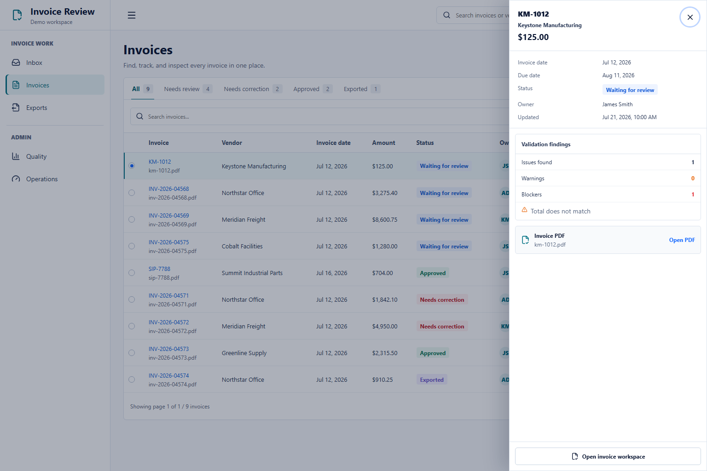
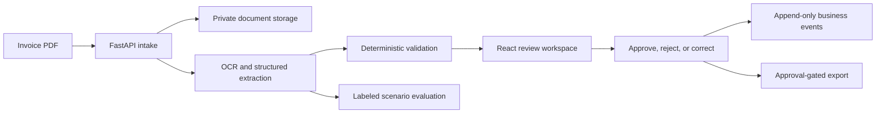

# AI-Powered Invoice Review & Approval System

A human-controlled accounts-payable workflow for comparing invoice PDFs with AI-extracted data,
correcting errors, recording reviewer decisions, and exporting only approved records. The concise
in-product name is **Invoice Review**.

The AP workflow can create a verified Purchase Invoice draft and, after a separate approval,
submit it in an explicitly enabled **local ERPNext sandbox**. It reads back the submitted invoice
and GL entries before marking posting verified. The earlier benchmark draft adapter remains
separate; the new workflow uses a versioned per-company posting profile. Another ERPNext site
requires its own company, supplier, item, account, tax, currency, and exchange-rate setup. See
[Phase 5 posting evidence](docs/evidence/invoice-review-v2/PHASE-5.md),
[ERPNext environment prerequisites](docs/erpnext-environment.md) and the
[integration boundary](docs/erpnext-integration-design.md).

[](docs/assets/demo/invoice-review-demo.mp4)

## How it works

```text
Upload PDF -> Read and extract -> Validate -> Review or correct
           -> Record decision -> Export approved invoice
```

The main product is organized around three daily tasks:

- **Inbox** shows invoices that need a decision or have a blocking issue.
- **Invoices** shows the full invoice lifecycle and provides the upload entry point.
- **Exports** contains approved invoices that can be prepared for delivery.

Administrators also have **Quality** for labeled evaluation results and **Operations** for failed
jobs, retries, integrations, and audit events.

## Who decides what

| Layer              | Responsibility                                                                               |
| ------------------ | -------------------------------------------------------------------------------------------- |
| Document providers | Read the PDF and propose invoice fields with source information.                             |
| Application rules  | Check required fields, totals, duplicates, state transitions, roles, and export eligibility. |
| Human reviewer     | Compare the PDF with the proposed data and approve, reject, or request a correction.         |

Confidence alone cannot approve an invoice. Validation errors block approval in both the UI and the
API. A correction keeps the original proposal and records the before/after values. Export is
available only after approval and uses idempotency controls to prevent duplicate execution.

## Architecture



The default local stack uses React, TypeScript, FastAPI, SQLite, and private local file storage. Mock
providers make the full workflow available without paid credentials. A temporary production-shaped
Azure profile has also been validated with Container Apps, PostgreSQL, private Blob Storage, Service
Bus, Functions/Event Grid, Key Vault, and Managed Identity, then fully torn down. See the
[controlled Azure live validation](docs/azure-live-validation.md). The tested real-provider
configuration uses OCR.space Engine 3 with API-key failover and an OpenAI structured
extraction model.

## Results

The frozen technical evaluation used **50 developer/AI-assisted synthetic invoices**
across 40 quality-holdout families, with ten duplicate pairs:

- **50/50 whole invoices correct**, including required field values and source provenance.
- **20/20 eligible invoices posted**, with independent submitted invoice and ledger checks.
- **30/30 non-payable transactions resolved** through authorized exception dispositions.
- All labeled quantity, price, receipt and duplicate discrepancies detected; no false holds,
  unsafe submissions or duplicate ERP effects.
- **20/20 restart replays** returned the same ERP target.
- Three dated rule/mapping revisions recovered with verified posting and retained all
  previously correct development cases.

The paired draft benchmark measured a **68.0% lower median elapsed workflow time**:
**153 seconds manually versus 49 seconds assisted**, across six synthetic invoices
and one operator in the local ERPNext sandbox. Both workflows ended at a verified
Purchase Invoice Draft. See [paired timing evidence](docs/erpnext-paired-draft-timing-results.md).

Phase 6 is complete under its technical acceptance contract. Its 50-invoice quality
and submitted-posting results are separate from the six-invoice draft timing study.
A new study of the full posting workflow remains an optional follow-up.

## Evidence at a glance

| Evidence                              | Direct record                                                                   |
| ------------------------------------- | ------------------------------------------------------------------------------- |
| Evaluation scope and method           | [Phase 6](docs/evidence/invoice-review-v2/PHASE-6.md)                           |
| Original whole-invoice quality        | [Quality report](docs/evidence/invoice-review-v2/quality-holdout/report.json)   |
| Discrepancy detection                 | [Discrepancy report](docs/evidence/invoice-review-v2/discrepancies/report.json) |
| ERP posting and restart verification  | [Posting report](docs/evidence/invoice-review-v2/posting/report.json)           |
| Rule changes and regression retention | [Replay report](docs/evidence/invoice-review-v2/replay/report.json)             |
| Paired verified-draft workflow timing | [Timing report](docs/erpnext-paired-draft-timing-results.md)                    |
| Local runtime samples                 | [Runtime report](docs/evidence/invoice-review-v2/runtime/report.json)           |
| Completion gates                      | [Phase 6 acceptance](docs/evidence/invoice-review-v2/phase6-validation.json)    |
| Product walkthrough                   | [Captioned demo video](docs/assets/demo/invoice-review-demo.mp4)                |

## Current limitations

The technical quality cohort contains controlled, one-line USD invoices with explicit
zero tax. The timing result covers six synthetic draft cases and one operator;
active human time and system waiting were not measured separately. These samples
do not establish accuracy on arbitrary customer invoices, production time savings,
production concurrency or production readiness. Docker/release checks cover local synthetic behavior. Invoice is the complete document workflow; SQLite, private local
storage and seeded roles remain the default evaluation profile. The earlier Azure
exercise was temporary integration validation and has been torn down. Every approval
still requires a reviewer.

## Quick start

For the fastest setup, use Docker Desktop. This starts both the API and background worker:

```powershell
.\scripts\start_docker.ps1
```

Open `http://127.0.0.1:8000` after the API reports ready.

For local source development, install Python 3.11+ and Node.js 22.22+ with npm 10 or 11:

```powershell
.\scripts\setup_local_venv.ps1

Push-Location frontend
npm ci
npm run build
Pop-Location

.\scripts\start_dev.ps1
```

The launcher supervises both the API and worker. Press Ctrl+C in its terminal to stop both.

Local demo credentials from `.env.example`:

| Role          | Token          |
| ------------- | -------------- |
| Uploader      | `uploader-123` |
| Reviewer      | `reviewer-123` |
| Administrator | `123`          |

Each token is exchanged for a server-owned role session. The default mock-provider profile requires
no external credentials.

For a provider-backed run, copy `.env.example` to the ignored `.env`, set
`PARSER_PROVIDER=mistral_ocr` and `EXTRACTOR_PROVIDER=llm_json`, and add the documented provider
credentials. Never commit `.env` or real invoice files. See [RUNBOOK.md](RUNBOOK.md) for the full
setup.

## Bounded Docker demo

After dependency setup and starting Docker Desktop:

```powershell
.\scripts\start_release.ps1 -Seed
```

This starts the capped API/worker profile and seeds a synthetic AP review with mock
providers and ERP writes disabled. See [Docker instructions](docs/docker_profile.md)
and [Phase 7 release evidence](docs/evidence/invoice-review-v2/PHASE-7.md).

## Tests and release checks

Run the complete local release check from a clean worktree:

```powershell
.\.venv\Scripts\python.exe scripts\verify_release.py --write-evidence
```

The command records the tested commit, environment, checks, test counts, and reviewed dependency
exceptions in [release verification](docs/evidence/release-verification.json). Real-provider
evaluation is separate because it requires credentials and paid API calls.

## Documentation

- [Portfolio case study](PORTFOLIO_CASE_STUDY.md)
- [Project tour](docs/recruiter-evidence-pack.md)
- [Usability study protocol](docs/usability-study-protocol.md)
- [Product requirements](PRD.md)
- [Architecture](ARCHITECTURE.md)
- [Runbook](RUNBOOK.md)
- [Roadmap](ROADMAP.md)
- [Scenario coverage matrix](SCENARIO_COVERAGE_MATRIX.md)
- [Technical evidence index](docs/INDEX.md)
- [Security posture](docs/security/SECURITY_POSTURE.md)
