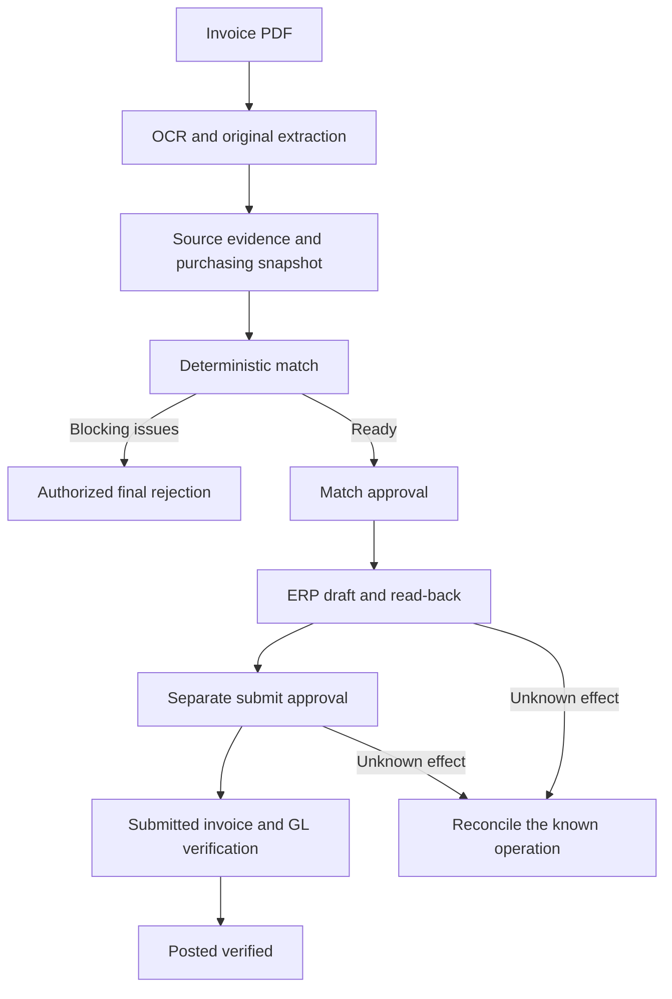

# Phase 6 — frozen technical evaluation

Phase 6 measures the PDF-to-ERP path using a sealed synthetic cohort. Original
provider extraction is scored before human correction. Deterministic match
decisions, authorized exception dispositions, separately approved submissions,
independent invoice/GL read-back and restart replay are measured separately.
The technical gates pass under contract 2.1.0. The operator time study is an
optional follow-up with its own sealed cohort.

## Implementation

Supplier grounding preserves the complete printed company name, including an
unambiguous business masthead or an OCR column-reflowed supplier field. Ambiguous
buyer/platform names remain ungrounded. Positional OCR handling preserves empty
table cells. Observed line evidence must come from a row containing the printed
description and numeric values; computed missing amounts do not become observed
amounts. Standalone money labels may ground an immediately following printed
amount, including explicit zero tax; percentages and tax identifiers are not money
amounts. Complete, unambiguous metadata and total blocks can also retain evidence
when OCR separates labels and values into columns. Missing values stay unknown;
printed arithmetic is checked only to disambiguate complete total blocks.
OCR engines 2 and 3 are configurable. Explicit provider cooldown metadata
is retained and the worker respects the upstream retry delay.

An AP approver can finalize a non-payable revision by rejecting each current
blocking issue with a reason and evidence. The rejection is bound to the current
match basis, remains visible in history and never enables posting. Changed
evidence reopens issues for reassessment. Approved matches or unreconciled ERP
operations require reconciliation before rejection. An unresolved correct hold
still receives safety credit but does not receive completion credit. ERP posting
also verifies the printed invoice due date. A prior invoice with incomplete
identity remains a duplicate candidate when its verified supplier and total match
on the same PO. It requires review and cannot enable automatic approval.

## Evaluation design

The frozen pack has 60 development families (70 invoices), 40 quality families
(50 invoices, including ten duplicate pairs), and 20 separate operator-study
families. Quality has 20 eligible submissions and 30 non-payable transactions.
PDF, label, procurement, timeline, expected-match, expected-posting and correction
artifacts are hashed. Source code, UI code, model, prompt, configuration, mappings
and evaluator hashes are recorded before final provider output. The source archive
retains the exact working tree; its base commit is the Phase 5 checkpoint. The
Phase 6 checkpoint includes the validated implementation and technical evidence.

The frozen provider profile is OCR.space Engine 3 and
`gpt-5.4-mini-2026-03-17`, with a 120-second request timeout, a 20,000-byte input
budget and 2,048 output tokens. Select `OCR_SPACE_ENGINE=3` to reproduce this
profile; the application's compatibility default remains Engine 2. Actual model,
prompt, configuration and source hashes accompany the results.

`OCR_SPACE_API_KEY` is the primary credential; optional comma-separated
`OCR_SPACE_API_KEYS` supply backups. Each request tries an available key at most
once, in order. A rate-limited key retains its own cooldown, rejected credentials
are disabled for that process, and transient connection failures briefly cool down
before reuse. Invalid invoice/OCR answers do not trigger credential retries.
Attempt records contain slot numbers and sanitized statuses, never key values.
When all keys are unavailable, the earliest remaining cooldown is returned to the
worker. This is an in-process failover mechanism, not a distributed rate limiter.

The final runner allows one retry of the same PDF only for an explicit HTTP 429
with a bounded upstream cooldown. All attempts and wait time are retained. Other
transient extractor transport failures allow one same-input retry; invalid answers
and schema failures are never retried for a better score. Remaining provider errors
and missing observations stay in scheduled denominators. The
sealed quality run has an exclusive run claim and cannot silently be replaced.
The duplicate-pair score uses the match service's actual emitted issue links;
invoice-identity grouping is retained only as a separate diagnostic.

Development replay covers three dated revisions: supplier alias mapping,
price tolerance and receipt correction. Each recovers to separately approved,
independently verified posting. Full regression replay remains 70/70 correct
after each revision, with previously unaffected cases retained at 69/69, 68/68
and 67/67. Changed price and receipt bases invalidate the old match approvals;
the receipt change also invalidates the old evidence snapshot.
See [replay evidence](replay/report.json).

## Technical results

The sealed quality run completed all 50 scheduled transactions. Original extraction
matched 50/50 whole invoices, including required page/excerpt provenance. All
processing and validation completed; validation-code sets matched 50/50.

| Check | Result |
| --- | --- |
| Quantity / price / receipt discrepancy recall | 30/30; 10/10; 20/20 |
| Duplicate transactions detected | 10/10; no false positives |
| Eligible invoices posted with independent invoice and GL checks | 20/20 |
| Authorized exception dispositions completed | 30/30 |
| False holds / unsafe approvals / unsafe submissions | 0 / 0 / 0 |
| Restart replay to the same ERP target | 20/20 |
| Duplicate ERP effects | 0 |
| Actual upload, queue and worker development samples | 3/3 succeeded |

The backend suite passed 717 tests with 13 skipped; the frontend suite passed
34 tests across ten files. Frontend build, Ruff and diff hygiene checks passed.
These results meet the technical gate on this controlled synthetic cohort.
See [quality](quality-holdout/report.json), [posting](posting/report.json),
[runtime](runtime/report.json) and [gate evidence](phase6-validation.json).
They do not complete the operator study or establish production performance.

## Optional operator follow-up

The isolated workspace is prepared with 20 untouched study PDFs and separate
manual/assisted purchasing sources. Its database, storage and queue readiness
checks pass. No study extraction or timer is started during preparation. The
counterbalanced worksheet schedules 40 conditions and keeps failed/skipped cases.
Capture tools retain original assisted extraction, actual final fields, authorized
dispositions, submitted invoice and GL evidence. A bare reference or saved draft
cannot establish a posted outcome. The scorer withholds a time-reduction claim
unless both conditions complete all 20 correctly with full evidence.

The [operator protocol](PHASE-6-STUDY.md) is available for a later study. It does
not block Phase 6 completion or Phase 7. No operator time reduction or combined
CV time/quality claim is currently available.

## Scope

These are developer/AI-assisted synthetic, one-line USD invoices with explicit
zero tax, distinct split-specific forms and controlled PO/receipt scenarios. They
are not externally sourced independent invoices. The local synchronous technical
harness uses synthetic approval identities and does not measure human handling
time. Runtime samples are local diagnostics, not production SLOs. Multi-line,
ambiguous real-world layouts, production concurrency, nonzero tax and exchange-rate
posting need separate evidence. Release/Docker validation belongs to Phase 7.

Latency samples include their stage counts. The evidence/match stage includes
snapshot preparation and approval bookkeeping; the ERP stage includes draft,
separate approval, submit and read-back. Provider cooldowns remain in elapsed
pipeline time and are reported explicitly. Token/page usage reflects returned
provider usage; charges for timed-out requests and actual billed dollars are
unverified.
