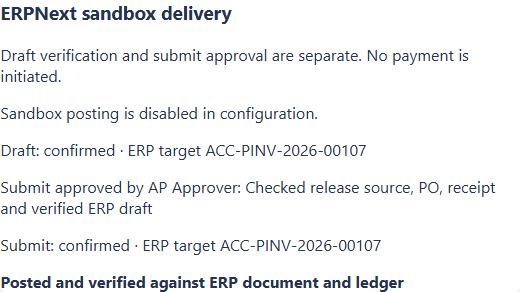

# Phase 7 — bounded Docker release validation

Phase 7 validates the local packaged application under contract 2.1.0. It covers
startup, persisted state, authority checks, submitted ERP invoice/ledger read-back,
response-loss recovery and write-flag rollback. The measured scope is controlled
synthetic data and the existing local ERPNext sandbox.

## Runtime and reproducibility

The default release topology uses API (512 MiB, 1 CPU) and worker (384 MiB, 0.5 CPU)
with private persistent SQLite/uploads, non-root execution, a read-only root,
dropped capabilities, no-new-privileges and PID limits. Ports bind to loopback.
PostgreSQL and the ERP sandbox are enabled only for their checks. The optional
loopback ERP bridge has a 64 MiB cap and permits writes only for `REL-` fixtures.

The tested image and its 206 runtime file hashes are recorded in
[release evidence](release/report.json) and [runtime files](release/runtime-files.json).
Validation binds the exact pre-checkpoint working-tree contents; the image records
its base revision with a dirty suffix. `scripts/build_release_image.py` builds a
clean commit-labelled image after checkpointing. OCI metadata follows dependency
layers so changing a release timestamp does not reinstall unchanged dependencies.
Local plans, private evaluation data, credentials and test outputs are excluded
from the build context.

From a dependency-ready checkout, the seeded demo is one command:

```powershell
.\scripts\start_release.ps1 -Seed
```

It selects mock providers, disables ERP writes, authors one synthetic PDF, runs
API/worker intake, applies explicit fixture review values, verifies evidence and
prepares a match. Uploader approval is rejected. It does not claim AI accuracy.
The offline evaluator can also run without provider credentials:

```powershell
.venv\Scripts\python.exe scripts/evaluate_phase1_regressions.py --output _local_docs/evaluator-regressions.json
```

See the [Docker runbook](../../docker_profile.md) for setup, roles, PostgreSQL,
sandbox provisioning, provider canary, rollback, backup/restore and teardown.

## Checks

| Check                         | Evidence                                                                                        |
| ----------------------------- | ----------------------------------------------------------------------------------------------- |
| Backend suite                 | 731 tests scheduled; 23 optional integration tests skipped; no failures                         |
| Coverage                      | 87.22% lines; 72.52% branches; thresholds 85% / 70%                                             |
| Frontend unit suite           | 36 passed across 10 files                                                                       |
| Browser regression            | 29 passed across desktop/tablet/mobile; 19 optional capture/layout scenarios skipped            |
| Real-backend browser workflow | 1 passed: process, correct, approve and export                                                  |
| Docker AP browser stages      | Intake/correction/approval/unknown submit; rollback/reconciliation; persisted verification      |
| PostgreSQL integration        | 7 persistence/SQL tests and 10 AP posting/recovery tests passed                                 |
| Container runtime             | Migration idempotency, API/worker, DB-loss readiness, liveness and graceful SIGTERM passed      |
| Static checks                 | Ruff format/lint, mypy on 59 configured files, frontend format/lint/build passed                |
| Dependencies                  | Python runtime lockfiles: no known vulnerabilities; npm: no unaccepted high/critical advisories |

Existing Phase 6 functions retain measured complexity ceilings; new functions keep
limits of 15 complexity, 80 lines and 300 lines per class. Large existing matching
and posting functions remain a maintenance limit.

## Final-image ERP journey

The browser uploads an authored PDF to the Docker API, the worker processes it
with mock providers, and the reviewer corrects a deliberate total mismatch.
Fixture line values and source attestations are explicit synthetic test setup.
The browser prepares and approves purchasing evidence, assesses and approves the
match, verifies the ERP draft, and separately approves submit.

The bridge deliberately drops the first successful submit response. The application
records `unknown` and retains the known target/reservation. After container recreation
with posting disabled, the approver reconciles the existing target through read-only
ERP calls. The submitted invoice and full GL match the independently authored oracle.
A later image restart preserves verified state and does not expose the old transport
error as an active issue. No second create or submit is needed for recovery.



A separate one-PDF canary on the final image uses OCR.space Engine 3 and the configured
JSON extractor. All 13 required original values and source anchors match the authored
invoice; no reviewer value correction is applied. It completes AP review, separate
approvals and independently verified ERP posting. These two final-image scenarios
produce two distinct authorized ERP invoices, exactly one target per operation.
The canary is a functional check, not a replacement quality benchmark.

Provider line anchors now retain their source page/excerpt when mapped to stable AP
line IDs. Capture still marks evidence unverified until reviewer attestation.
Rollback disables new writes while leaving known-operation reconciliation available
to the authorized roles. Historical error events remain in the operation ledger.

## Storage and boundaries

The quiesced-volume drill backs up SQLite and uploads, restores into a separate
folder, validates integrity/foreign keys, and matches document/job/extraction/audit/AP
row hashes and upload hashes. It does not overwrite the live database. A separate
Phase 6 database opens under the current runtime with all 50 documents and 634 AP
history rows retained. PostgreSQL migrations 1–5 and reapplication are verified.

This is local restoration, not off-host disaster recovery or ERP database restoration.
Cloud deployment, managed hosting, production concurrency and customer-data performance
are outside this phase. The original six-invoice verified-draft timing claim remains
separate from these submitted-posting checks and the Phase 6 quality cohort.
The optional new operator study remains deferred. No payment or cloud deployment is
performed by Phase 7.
